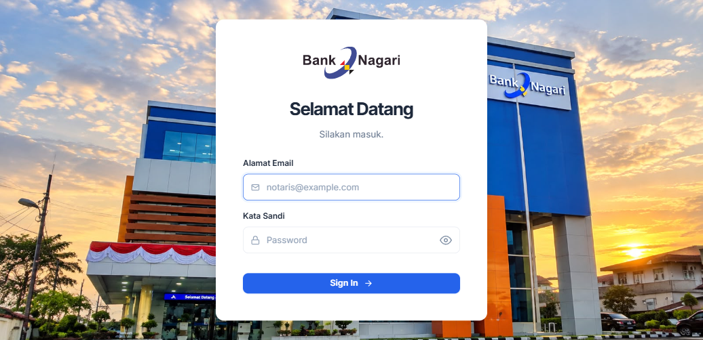

# Nagari General Affair System (NGAS)

Sistem Informasi Manajemen General Affair (Divisi Umum) Bank Nagari untuk sentralisasi dan pengelolaan operasional inventaris Alat Tulis Kantor (ATK), Kendaraan Dinas/Operasional, Aset Inventaris Kantor, Keamanan Lingkungan Kerja, dan Pelaporan Multi-Cabang.

---

## Tampilan Antarmuka

### Halaman Login


---

## Modul & Fitur Utama

### 1. Manajemen ATK (Alat Tulis Kantor)
* **Master ATK & Inventaris**: Pendataan katalog barang ATK lengkap dengan kode, nama, kategori, dan batas stok minimum.
* **Integrasi QR Code**: Fitur generate QR Code dengan penyematan logo Bank Nagari di tengah QR, cetak QR satuan, dan cetak bulk/massal.
* **Scan Barcode / QR**: Pemindaian cepat QR Code melalui scanner untuk lookup detail item ATK.
* **Permintaan & Pemakaian ATK**: Alur pengajuan permintaan, verifikasi stok cabang, dan pencatatan pemakaian harian.
* **Monitoring & Jurnal Stok**: Pelacakan saldo stok per cabang dan pencatatan mutasi transaksi masuk/keluar.

### 2. Operasional Kendaraan
* **Master Kendaraan**: Pendataan armada dinas/operasional (plat nomor, jenis, tipe, tahun, dan status penugasan cabang).
* **Catatan Perjalanan Dinas**: Monitoring rute perjalanan, odometer (awal & akhir), pengemudi, serta unggah bukti dokumentasi foto perjalanan.
* **Pencatatan Bahan Bakar (BBM)**: Tracking pengisian BBM, jenis BBM, biaya, liter, odometer, serta lampiran bukti struk.
* **Pemeliharaan & Servis**: Riwayat servis berkala, perbaikan kendaraan, biaya perawatan, dan lampiran nota bengkel.

### 3. Inventaris Aset Kantor
* **Pencatatan Aset Fisik**: Registrasi aset berwujud kantor, nomor registrasi, kondisi (baik, rusak ringan, rusak berat), dan alokasi cabang.
* **Multi-Dokumen & Lampiran**: Dukungan upload banyak dokumen legalitas / foto fisik aset (PDF, JPG, PNG).

### 4. Manajemen Keamanan (Security & K3)
* **Evaluasi & Pengawasan**: Checklist dan evaluasi berkala sistem keamanan, CCTV, APAR, dan pos jaga.
* **Audit Trail / Activity Log**: Rekam jejak seluruh aktivitas user dalam sistem guna transparansi dan akuntabilitas.

### 5. Multi-Cabang (Branch Management)
* **Pengelolaan Cabang**: Manajemen hingga 5 kantor cabang Bank Nagari dengan kode cabang 3 karakter.
* **Isolasi & Pemisahan Data**: Filter otomatis transaksi stok, kendaraan, aset, dan permintaan berdasarkan cabang kerja.

### 6. Rekapitulasi & Pelaporan
* Laporan komprehensif untuk ATK, Kendaraan, dan Aset.
* Filter dinamis berdasarkan periode tanggal dan cabang.
* Ekspor laporan ke format dokumen resmi (PDF & Excel).

---

## Hak Akses (Role & Permission)

| Role | Deskripsi Hak Akses | Akun Default (Seeder) |
| :--- | :--- | :--- |
| **Admin** | Akses penuh: Master data ATK, Kendaraan, Aset, Pengelolaan Cabang, Verifikasi Permintaan, Audit Logs, dan Seluruh Laporan. | `admin@banknagari.co.id` / `admin123` |
| **Staff** | Akses operasional: Pengajuan permintaan ATK, input pemakaian harian, pencatatan perjalanan kendaraan, BBM, dan pemeliharaan. | `staff@banknagari.co.id` / `staff123` |

---

## Persyaratan Sistem

* **PHP**: `>= 8.2` (dengan ekstensi: `pdo_mysql`, `zip`, `gd`, `fileinfo`, `mbstring`)
* **Database**: MySQL `>= 8.0` atau MariaDB `>= 10.4`
* **Composer**: `>= 2.0`
* **Web Server**: Apache / Nginx / PHP Built-in Server

---

## Petunjuk Instalasi & Menjalankan Aplikasi

1. **Clone Repository & Masuk Direktori**
   ```bash
   git clone https://github.com/RimuruTempestCkCK/NagariGeneralAffairSystem.git
   cd NagariGeneralAffairSystem
   ```

2. **Install Dependensi PHP**
   ```bash
   composer install
   ```

3. **Konfigurasi Environment (`.env`)**
   Salin `.env.example` ke `.env` dan sesuaikan koneksi database Anda:
   ```env
   DB_CONNECTION=mysql
   DB_HOST=127.0.0.1
   DB_PORT=3306
   DB_DATABASE=nagarigeneralaffairsystem
   DB_USERNAME=root
   DB_PASSWORD=
   ```

4. **Generate Application Key & Storage Link**
   ```bash
   php artisan key:generate
   php artisan storage:link
   ```

5. **Migrasi Database & Seeder Data Awal**
   ```bash
   php artisan migrate:fresh --seed
   ```

6. **Jalankan Server Lokal**
   ```bash
   php artisan serve
   ```
   Akses aplikasi melalui browser di: `http://127.0.0.1:8000`

---

## Ketentuan & Validasi File Upload

* **Foto Perjalanan, Struk BBM, & Nota Pemeliharaan**: Format JPG, PNG, atau WebP (maksimal 5 MB per foto).
* **Lampiran Aset**: Format PDF, JPG, atau PNG (maksimal 10 MB per file, mendukung multi-file upload).
